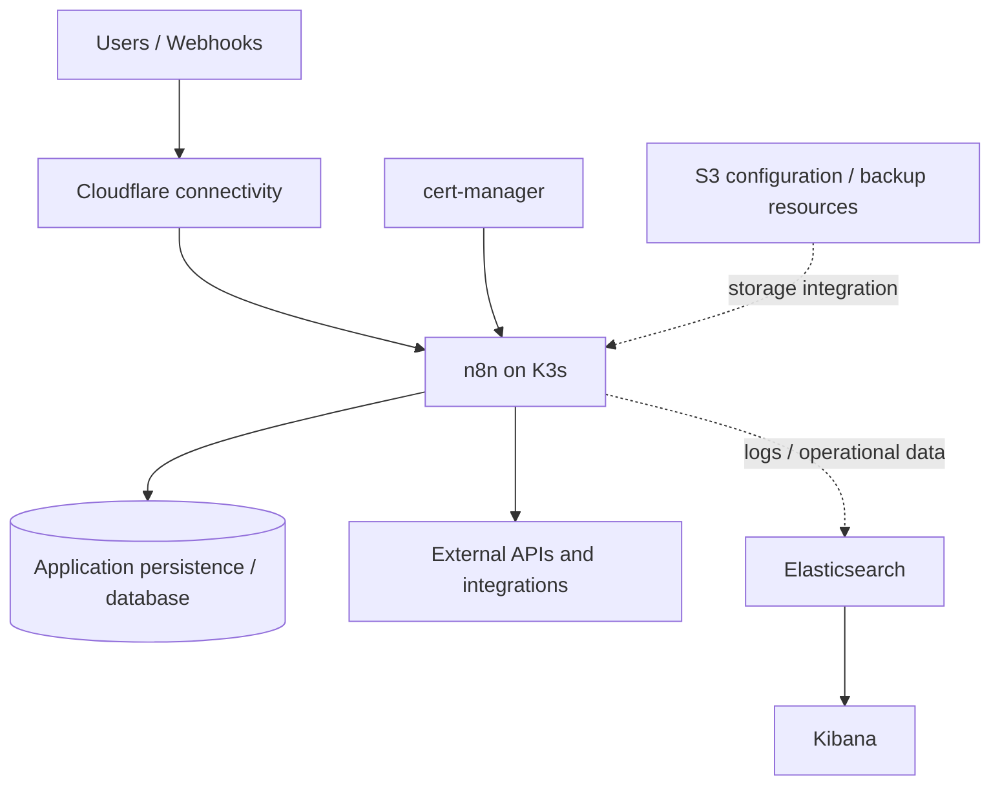

# N8NStack

**Self-hosted n8n automation infrastructure on K3s, with TLS management, Cloudflare connectivity, observability, and S3-related deployment resources.**

N8NStack is an infrastructure-as-code-oriented collection of Kubernetes manifests, configuration, and shell scripts for operating an n8n automation platform. It brings together a lightweight Kubernetes cluster, certificate management, n8n workloads, an Elasticsearch/Kibana logging stack, and supporting Cloudflare and S3 configuration.

> **Important:** This repository contains environment-specific deployment scripts. Review and adapt all paths, secrets, namespaces, service accounts, and storage settings before running them. The main `install.sh` **starts by uninstalling an existing K3s installation**, so it must **not** be run unmodified on a machine with workloads or data you want to retain.

## Architecture



*Conceptual overview. Actual network routes, storage integrations, and database topology depend on the manifests and environment configuration.*

## Repository structure

| Path | Purpose |
| --- | --- |
| [`n8n/`](./n8n/) | Kubernetes resources for the n8n application |
| [`cert-manager/`](./cert-manager/) | Certificate-management configuration |
| [`cloudflared/`](./cloudflared/) | Cloudflare connectivity and tunnel-related configuration |
| [`elk/`](./elk/) | Elasticsearch / Kibana configuration |
| [`s3/`](./s3/) | S3-related resources and configuration |
| [`install.sh`](./install.sh) | K3s, cert-manager, n8n, and ELK installation script |
| [`install copy.sh`](./install%20copy.sh) | Alternate installation script; inspect before use |
| [`b64encode.sh`](./b64encode.sh) | Base64 helper script; inspect inputs and outputs before use |
| [`commands.txt`](./commands.txt) | Operational command notes |

## Technology stack

- **K3s / Kubernetes:** Container orchestration for the application and supporting services.
- **n8n:** Workflow automation and integration engine.
- **cert-manager:** Kubernetes certificate lifecycle management.
- **Cloudflare / cloudflared:** Connectivity and tunnel-related components.
- **Elasticsearch and Kibana:** Search, logging, and operational inspection.
- **Helm and Kustomize:** Deployment and configuration management.
- **S3:** Storage-related integration resources.

## Prerequisites

Before deployment, prepare:

1. A Linux host or VM suitable for K3s, with sufficient CPU, memory, and persistent disk for n8n and Elasticsearch.
2. Administrative access, `curl`, `kubectl`, and `helm`.
3. A domain and Cloudflare configuration if external access through Cloudflare is desired.
4. Required Kubernetes Secrets, including application credentials and any GitHub or Kubernetes API tokens used by your workflows.
5. A database and persistent-volume strategy appropriate for your environment.
6. S3 credentials, permissions, and a bucket if using S3-backed storage or backups.

> The sample installer uses hard-coded `/home/adm02/n8n-test/...` paths and an `adm02` account. Change these to match your machine. It also changes the permissions of the K3s kubeconfig; restrict access appropriately instead of exposing cluster credentials broadly.

## Deployment guide

### 1. Clone the repository

```bash
git clone https://github.com/cray9741/N8NStack.git
cd N8NStack
```

### 2. Review configuration and secrets

Inspect the manifests and scripts before applying them:

```bash
find n8n cert-manager cloudflared elk s3 -type f
sed -n '1,220p' install.sh
```

Verify Kubernetes contexts, hostnames, namespaces, container images, storage claims, and Secret references. Do **not** commit live tokens, API keys, passwords, or unencrypted credential files.

### 3. Install or connect to K3s

For a **new, disposable host only**, follow the [official K3s installation guide](https://docs.k3s.io/quick-start) and configure `kubectl` to access your cluster. Avoid executing `install.sh` directly: its first command removes an existing K3s installation.

```bash
kubectl get nodes
kubectl cluster-info
```

### 4. Install cert-manager

The repository's installer references cert-manager **v1.16.1**. Confirm compatibility with your cluster and review current security updates before selecting a version.

After installing cert-manager according to its [official documentation](https://cert-manager.io/docs/installation/), inspect and apply the local overlay:

```bash
kubectl kustomize ./cert-manager
kubectl apply -k ./cert-manager
kubectl get pods -n cert-manager
```

### 5. Deploy n8n

Create the namespace if necessary, verify that the referenced Secrets and service accounts exist, and apply the n8n configuration:

```bash
kubectl create namespace n8n --dry-run=client -o yaml | kubectl apply -f -
kubectl kustomize ./n8n
kubectl apply -k ./n8n
kubectl get pods,svc,deploy -n n8n
```

The included installer patches the `n8n` Deployment to use service account `n8n-k8s` and references Kubernetes Secrets `n8n-k8s-token` and `github-token`. Create those resources securely if required by your deployment. Check that a patch will not overwrite an existing environment-variable list before using it.

### 6. Configure external connectivity

Review [`cloudflared/`](./cloudflared/) for the tunnel configuration and verify DNS, ingress, TLS, and n8n's public webhook URL settings. Use least-privilege Cloudflare credentials and ensure the n8n editor is protected with authentication.

### 7. Deploy and validate observability

The sample installer adds the Elastic Helm repository and deploys single-replica Elasticsearch plus Kibana in a `logging` namespace. Review the [`elk/`](./elk/) manifests and current Elastic Helm chart compatibility before deployment; the install script also sets Kibana's service type to `LoadBalancer`, which may expose it externally.

```bash
kubectl get pods,svc -n logging
kubectl get events -n logging --sort-by=.lastTimestamp
```

Protect Elasticsearch and Kibana with authentication and network restrictions. Avoid printing credentials into shared terminals or CI logs.

### 8. Validate the platform

```bash
kubectl get nodes
kubectl get pods -A
kubectl get ingress -A
kubectl logs -n n8n deployment/n8n --tail=100
kubectl rollout status -n n8n deployment/n8n
```

Confirm that n8n is reachable at the configured hostname, that workflows execute successfully, and that persistence survives pod restarts.

## Operations

### Troubleshooting

| Symptom | What to check |
| --- | --- |
| n8n pods not starting | `kubectl describe pod -n n8n <pod>`; image pulls, Secret references, volume mounts |
| Workflows cannot reach APIs | DNS, network policy, egress, Cloudflare routing, credentials |
| TLS or hostname errors | cert-manager resources, certificate status, DNS records, ingress/tunnel configuration |
| Elasticsearch or Kibana unavailable | Pods, PVC capacity, memory limits, service exposure, chart compatibility |
| Lost workflows or settings | Database persistence, backup status, restore procedures |

### Backup and recovery

Treat backups as an operational requirement, not an optional feature. Verify what is actually configured under [`s3/`](./s3/) and back up the n8n database, encryption key, and any persistent data required for recovery. Test restores in a separate environment before relying on them in production. Configure S3 encryption, access restrictions, and retention policies where applicable.

### Security checklist

- [ ] Remove all hard-coded host paths and account assumptions.
- [ ] Keep Kubernetes kubeconfig and service account tokens restricted.
- [ ] Store secrets in a secure secrets manager or Kubernetes Secrets with appropriate protections.
- [ ] Apply least-privilege RBAC to n8n and integrations.
- [ ] Require authentication and TLS for public endpoints.
- [ ] Restrict Elasticsearch/Kibana exposure.
- [ ] Pin and regularly update supported component versions.
- [ ] Configure persistent storage, backups, retention, and restore testing.
- [ ] Review scripts for destructive commands before execution.

## Project scope

This repository is best treated as a **deployment reference and starting point**, rather than a turnkey production installer. Its scripts and configuration require environment-specific review and security hardening. The documented architecture reflects the repository's visible directories and installer; not every integration shown is necessarily enabled in every deployment.

## Related project

- [N8N_Workflows](https://github.com/cray9741/N8N_Workflows) — workflow definitions that can complement this infrastructure stack.

## Author

Maintained by [cray9741](https://github.com/cray9741).
